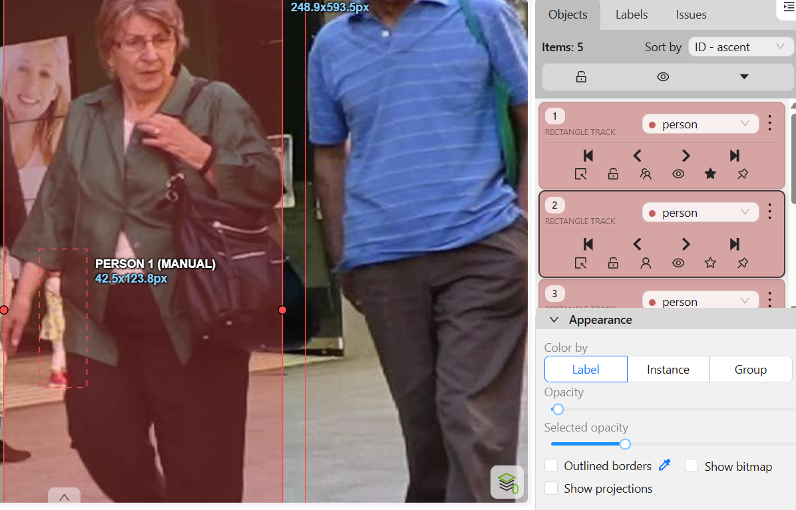
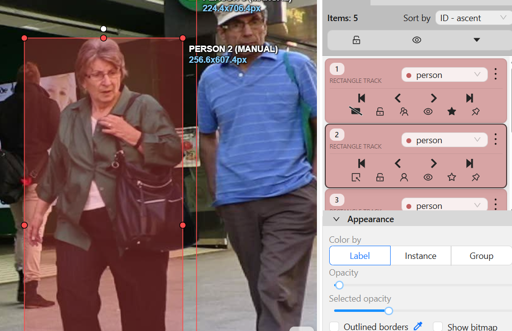
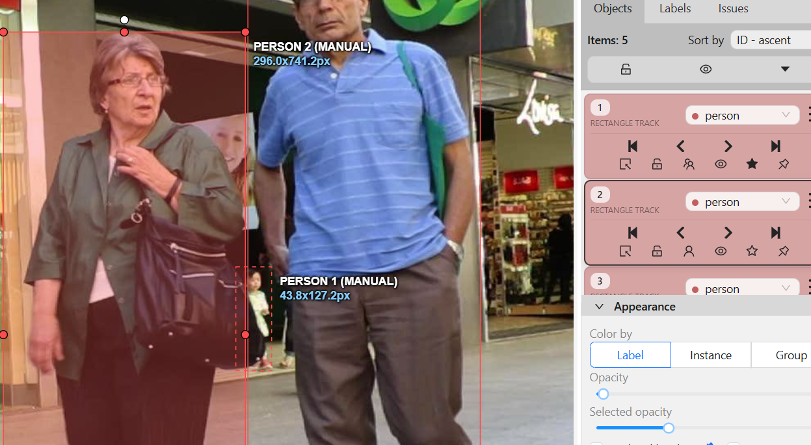

# Báo cáo cá nhân — HoVaTen-MSSV

Đổi tên file theo quy tắc `MSSV_HoTen.md`. Ví dụ: `20241234_NguyenVanAn.md`.

Đoạn video: MOT17-09, 150 frame (frame 1–150), nguồn MOTChallenge, giấy phép CC BY-NC-SA 3.0.

## 0. Thông tin học viên

- Họ tên: Đặng Quốc Thái
- MSSV: 202603166
- Mã đề (A/B/C): A
- Email:
- Link repository:
- Giờ bắt đầu:
- Giờ kết thúc:

## 1. Xem trước đoạn video (CP0)

Ghi **trước khi vẽ**, mỗi người một dòng.

| Mã | Frame xuất hiện | Frame cuối thấy được | Rẽ / dừng / đổi tốc độ ở frame | Bị che ở frame | Ghi chú |
|---|---|---|---|---|---|
| P1 | 0 | 150 | 106 | 40 | |
| P2 | 39 | 150 | Không có | Không có | |
| P3 | 0 | 150 | Không có | Không có | |
| P4 | 0 | 150 | Không có | Không có | |
| P5 | 0 | 150 | 29 | 111 | |

## 2. Keyframe và thời gian (CP1, CP4)

Số keyframe lấy từ kết quả `src/check_submission.py`.

| Mã | Số keyframe | Keyframe ở frame | Số frame có mặt | Keyframe / 100 frame | Thời gian (phút) | Chỗ khó |
|---|---|---|---|---|---|---|
| P1 | 29 | [0, 10, 20, 30, 35, 37, 39, 40, 44, 49, 50, 51, 52, 53, 54, 55, 60, 70, 80, 90, 100, 101, 110, 111, 112, 120, 130, 140, 149] | 147 | 19.7 | 10 | Chỗ bị khuất frame 40 |
| P2 | 11 | [61, 71, 81, 91, 100, 101, 111, 121, 131, 141, 149] | 89 | 12.4 | 6 | |
| P3 | 17 | [0, 10, 20, 30, 40, 50, 60, 64, 70, 80, 90, 100, 110, 120, 130, 140, 149] | 150 | 11.3 | 4 | |
| P4 | 12 | [60, 61, 64, 70, 80, 90, 100, 110, 121, 131, 141, 149] | 90 | 13.3 | 3 | |
| P5 | 19 | [0, 4, 10, 20, 30, 40, 50, 60, 80, 90, 106, 109, 110, 131, 136, 137, 138, 140, 142] | 125 | 15.2  | 7 | Chỗ bị khuất frame 111 |
| **Tổng** | 88 | | 601 | 14.6 | 30 | |

Keyframe / 100 frame của cả bài = tổng keyframe ÷ tổng số frame có mặt × 100 = ...

Bạn đặt keyframe nhiều nhất ở người nào? Vì sao (người đó rẽ, dừng, lại gần camera hay bị che)?

P1, bởi lẽ người này bị che khuất rất nhiều cùng vời nhiều đoạn đổi hướng di chuyển

## 3. Đoạn bị che (CP2)

Người bị che: `P5`

| Mốc | Frame |
|---|---:|
| Bắt đầu bị che một phần (bật `occluded`) | 106 |
| Mất hẳn (bật `outside`) | 111 |
| Hiện lại (tắt `outside`) | |
| Thấy rõ trở lại (tắt `occluded`) | |

- Thời gian khuất hẳn: 26 frame = 4 giây.
- Quyết định: giữ cùng ID.
- Lý do (trả lời 3 câu: khuất bao lâu so với 60 frame, ngoại hình có khớp, chỗ hiện lại có đúng hướng và tốc độ):

Chỉ khuất 26 frame, ngoài hình vẫn khớp, đối tượng vẫn đứng yên trong suốt thời gian bị khuất

Ảnh chụp màn hình:





## 4. Tự review ID (CP3)

Lượt 1 theo người (đi ngược từ frame 149 về 0 trên CVAT), lượt 2 theo cảnh (nhảy 10 frame). Ít nhất 3 dòng; không có lỗi thì ghi một dòng "đã kiểm hai lượt, không lỗi".

Loại lỗi dùng đúng một trong 7 mã: `id_switch`, `fragmentation`, `lost`, `merge`, `false_track`, `drift`, `flag`.

Đã kiểm hai lượt, không lỗi

| Frame | Mã người | Loại lỗi | Mô tả một câu | Phát hiện ở lượt | Đã sửa? |
|---:|---|---|---|---|---|
| | | | | | |
| | | | | | |
| | | | | | |

Tổng hợp số lỗi theo loại:

| `id_switch` | `fragmentation` | `lost` | `merge` | `false_track` | `drift` | `flag` |
|---:|---:|---:|---:|---:|---:|---:|
| | | | | | | |

Lỗi nào chỉ lượt 2 (theo cảnh) mới thấy, lượt 1 (theo người) không thấy? Vì sao?

...

## 5. File xuất và kết quả tự kiểm (CP4)

| Kiểm tra | Kết quả |
|---|---|
| Tên file MOT 1.1 | DangQuocThai_mot.zip |
| Tên file CVAT for video 1.1 | DangQuocThai_cvat_video.zip |
| Số track ID khác nhau trong `gt/gt.txt` (phải là 5) | 5 |
| Frame `outside` không có dòng trong `gt.txt` (đúng / sai) | Đúng |
| Job đã completed trên CVAT máy cá nhân | 1 |

Dán phần tóm tắt in ra từ `src/check_submission.py`:

```text
  Lỗi: 0   |   Cảnh báo: 0
  Đạt. Dán phần tóm tắt này vào báo cáo mục 5.
```

## 6. Ba câu kết

1. Nếu được gán lại, bạn sẽ đặt keyframe khác ở đâu? Vì sao?

   Tôi sẽ đặt Keyframe tại nơi P2 bước ra cửa hàng, bởi lẽ thay đổi tốc độ của và hướng di chuyển của đối tượng rất quan trọng trong tracking

2. Có chỗ nào bạn không chắc "cùng ID hay ID mới"? Bạn đã quyết định và ghi chú thế nào?

   Tôi hoàn toàn chắc chắn toàn bộ ID của cả 5 người vì tất cả họ đều không bị khuất hay bị khuất quá lâu để gán ID mới

3. Một lỗi ID trong job của bạn (nếu không còn sót, chọn lỗi đã sửa) có thể làm xe tự lái dự đoán sai chuyển động của người đó như thế nào? Lỗi đó ảnh hưởng MOTA hay IDF1 nhiều hơn?

   Tôi đã sửa lỗi P5 tắt outside quá sớm trước khi export lần đầu, và lỗi này có thể khiến hệ thống ngừng theo dõi một người dù họ vẫn còn xuất hiện một phần trong khung hình. Điều này khiến dữ liệu vị trí và quỹ đạo chuyển động bị gián đoạn. Đối với xe tự lái, việc mất thông tin liên tục có thể khiến hệ thống dự đoán sai hướng di chuyển của người đi bộ, ảnh hưởng đến khả năng đánh giá tình huống giao thông. Lỗi này có thể ảnh hưởng đến cả MOTA và IDF1, nhưng IDF1 thường nhạy cảm hơn nếu lỗi dẫn đến mất tính liên tục của danh tính đối tượng.

## Bonus (nếu làm)

### B1 — Hai người đi sát


### B2 — So cách đặt keyframe

| Cách đặt | Số keyframe | Frame trôi nhất | Ghi chú |
|---|---:|---:|---|
| Đều mỗi 30 frame | | | |
| Theo chỗ đổi hướng | | | |

...

### B3 — So với tracker có sẵn

| Frame | Mã người | Tracker làm gì | Nhãn của bạn | Giải thích (đoán rồi sửa / ghép IoU / box score thấp / ngoại hình) |
|---:|---|---|---|---|
| | | | | |
| | | | | |

## 7. Tài liệu tham khảo và công cụ AI đã dùng


